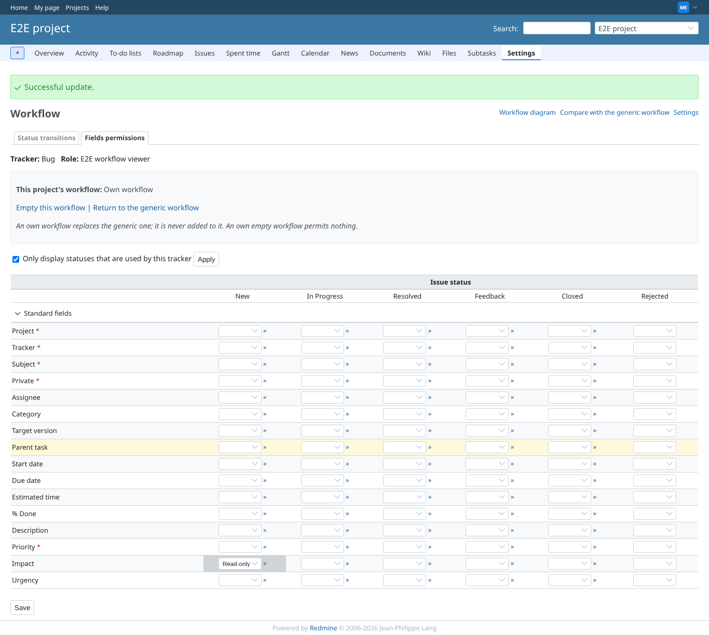
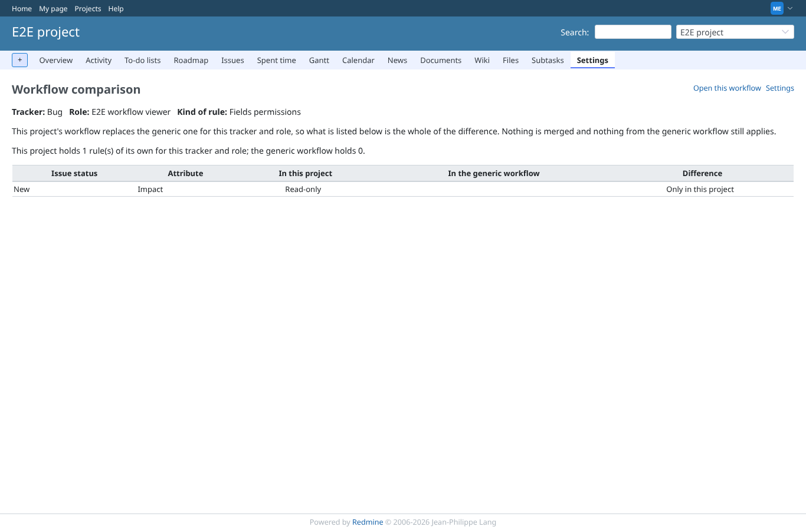
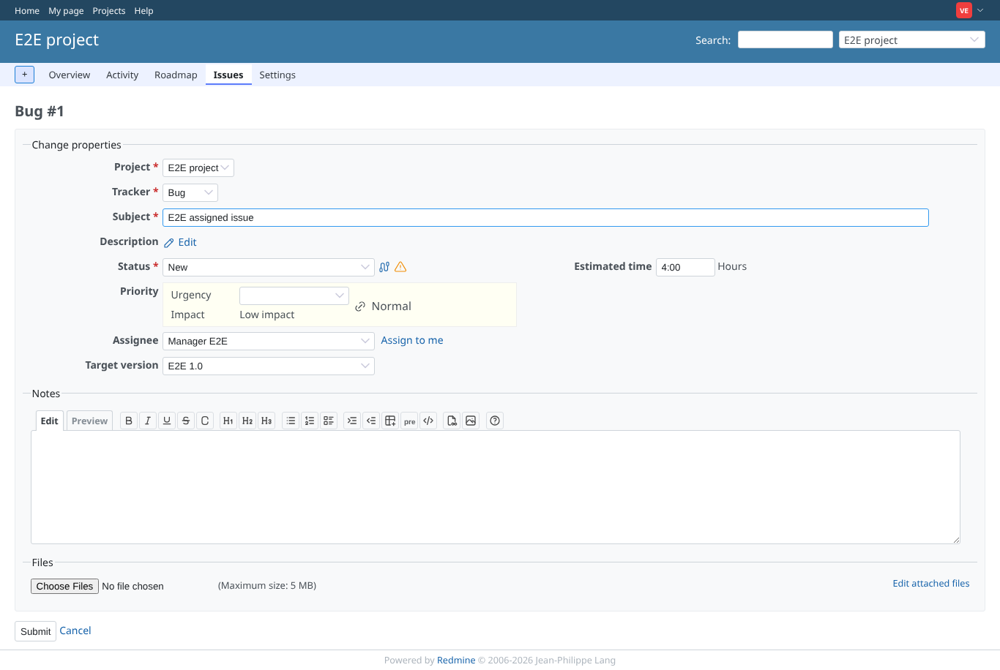
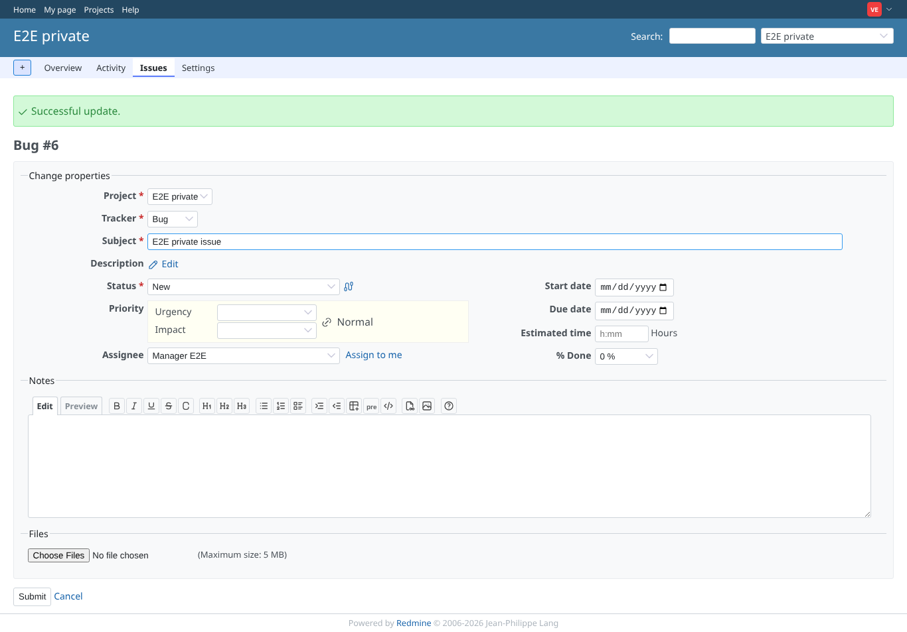
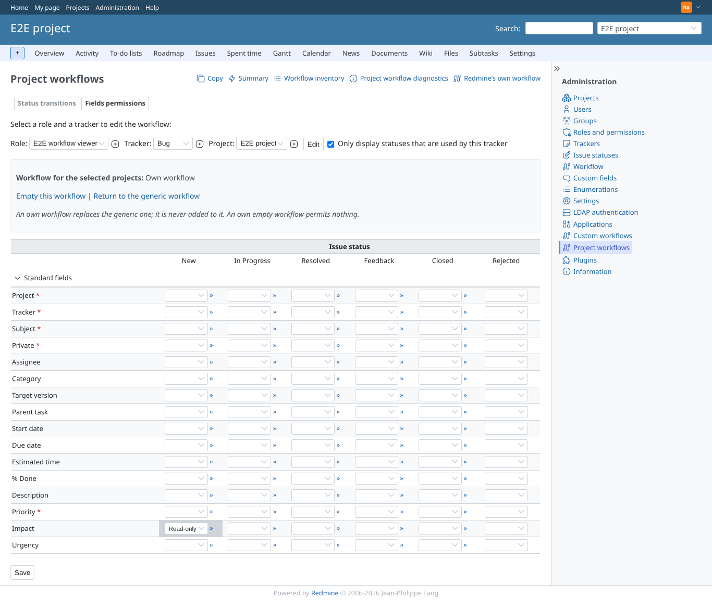
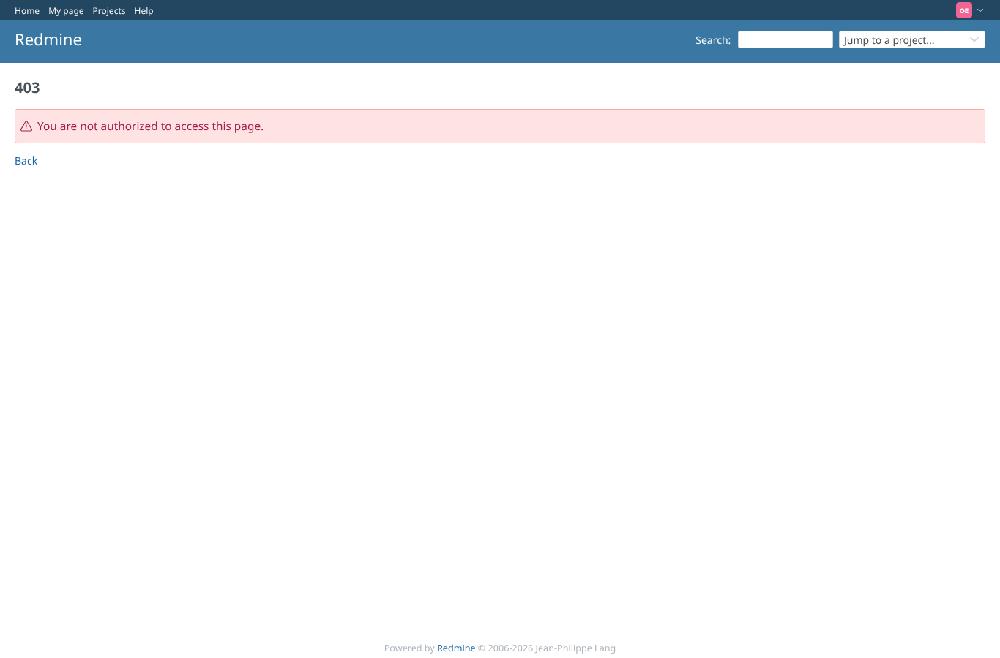

# neighbour_fields_per_project

Run 2026-10-12T11:40:00.494Z against http://127.0.0.1:3000.

| screenshot | user | URL | shows |
|---|---|---|---|
|  | manager | `/projects/e2e-project/workflow/permissions?role_id=7&tracker_id=1&used_statuses_only=` | Manager: e2e-project own Fields permissions for Bug x E2E workflow viewer, with Impact and Urgency rows; Impact read-only for New saved |
|  | manager | `/projects/e2e-project/workflow/compare?tracker_id=1&role_id=7&rule_type=permissions` | Manager: the comparison names the Impact rule as only in this project |
|  | viewer | `/issues/1/edit` | Viewer in e2e-project: Impact is read-only (no select), Urgency still editable |
|  | viewer | `/issues/6/edit` | Viewer in e2e-private: the generic workflow applies, Impact is editable |
|  | admin | `/project_workflow_rules/permissions?tracker_id[]=1&role_id[]=7&project_id[]=1` | Admin: Project workflows -> Fields permissions for e2e-project shows Impact (read-only for New) and Urgency |
|  | outsider | `/project_workflow_rules/permissions?tracker_id[]=1&role_id[]=7` | Outsider: the project and administration Fields permissions answer 403 (reporter: 403 as well) |
